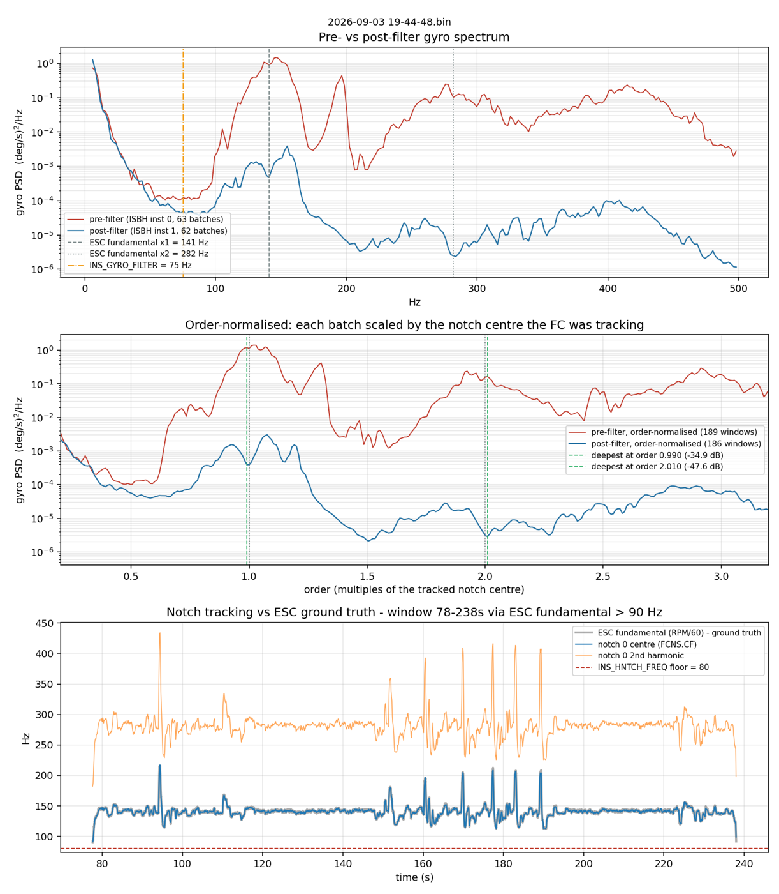

# ardupilot-log-tools

**An agent-first toolkit for analysing ArduPilot / ArduCopter dataflash (`.bin`) logs.**

The goal of this project is to let an AI agent analyse a flight log *efficiently* and
*accurately*. Everything follows from that: the parser fails loudly instead of quietly
patching bad input, every number comes with its window, its threshold and the threshold's
source, every command has a JSON form with a published schema, and the documentation is
written for the agent doing the analysis rather than for a person looking at plots.

```bash
alog info flight.bin        # what is this, is it intact, what was logged
alog all  flight.bin        # the standard battery, markdown
alog all  flight.bin --json # the same, one JSON document
```

```
# Log analysis - example-flight.bin

**Log integrity:** 0 error(s), 1 warning(s), 1 info in log integrity.
- [WARNING] TRUNCATED_TAIL: file ends 15 bytes into a RTC message (5 of 20 bytes present) ...

Window: 77.4-277.8 s (200.4 s) via **EV NOT_LANDED->LAND_COMPLETE**. Quote this method when comparing flights.

## Motors and standing trim
[FAIL] roll trim: 34.256 us standing trim (warn 10, fail 25)
[FAIL] pitch trim: -36.738 us standing trim (warn 10, fail 25)
[PASS] yaw trim: 0.562 us standing trim (warn 10, fail 25)

| axis     | trim (us) | reads as                                         |
| -------- | --------: | ------------------------------------------------ |
| roll     |      34.3 | mean(left) - mean(right)                         |
| pitch    |     -36.7 | mean(front) - mean(rear); negative = CG aft      |
| yaw      |       0.6 | mean(CCW) - mean(CW); non-zero = standing torque |

Channel -> motor map from SERVOn_FUNCTION: M1=C2, M2=C3, M3=C4, M4=C1.
```

Exit code 0 / 1 / 2 is pass / warn / fail; 3 means the input could not be analysed.

---

## Core values

1. **Fail loudly.** Nothing wrong with the input is ever silently repaired. Truncation,
   resync, unknown message types, malformed `FMT` records, NaN fields, logging gaps and
   duplicated blocks are all recorded with a stable code, a byte offset and a count, printed
   at the top of every report and carried in every JSON document
   (`reference/integrity-codes.md`). `--strict` refuses a log with any error-level issue.
   A check that cannot run is `SKIP`, never a pass.
2. **State the number, the window and the source.** Every result carries its value, its
   thresholds and where the thresholds came from (`dflog/checks.py::T`,
   `reference/thresholds.md`). Every report names the window and the method that chose it.
3. **Agents first.** `--json` everywhere with one contract (`alog schema`,
   `reference/json-output.md`); structured tables, not markdown inside JSON; deterministic
   output; errors that say what *does* exist. `RULES.md` is the short contract; `GUIDE.md`
   the operating guide.
4. **Platform agnostic.** Pure Python 3.9+ on Windows, Linux and macOS; no shell scripts on
   the critical path; UTF-8 output. The test suite runs locally (`tools/ci_local.py`); there is no cloud CI.

---

## Install

```bash
pip install git+https://github.com/geoffreyheller/ardupilot-log-tools                     # puts `alog` on PATH
uvx --from git+https://github.com/geoffreyheller/ardupilot-log-tools alog info flight.bin # or run it without installing (uv)
pip install "ardupilot-log-tools[plot] @ git+https://github.com/geoffreyheller/ardupilot-log-tools"  # plus matplotlib, for --plot
```

Python 3.9+ with numpy, pandas and scipy, on Windows, Linux or macOS. No pymavlink, nothing
to compile. The wheel carries the documentation: `alog docs` lists it, `alog docs pitfalls`
prints one, matching the installed version.

### From a clone

```bash
git clone https://github.com/geoffreyheller/ardupilot-log-tools.git
cd ardupilot-log-tools
pip install -e ".[test]"                 # `alog` on PATH, editable
python alog.py --help                    # or, without installing anything: the same command
```

`python alog.py …` and `alog …` are the same program; the rest of the documentation writes
`alog`.

---

## Use as an agent skill

`skills/ardupilot-log-analysis/` is an agent skill in the open
[Agent Skills](https://agentskills.io) format: a `SKILL.md` that tells any coding agent how
to run `alog` and read its output, the tool's own documentation in `references/`, and
`scripts/alog.sh` / `alog.ps1`, which run the matching `alog` (installing it through `uvx`
or `pipx` on first use). It contains nothing specific to one agent. Install it once, at
user level, and every project sees it; or at project level, to share it with a repository.

Pick one:

```bash
# GitHub CLI 2.90+ (`gh skill` is in preview): any agent it knows, at user or project scope
gh skill install geoffreyheller/ardupilot-log-tools ardupilot-log-analysis --agent github-copilot --scope user

# From an installed alog: copies the skill that matches its version, offline
alog install-skill --dir ~/.agents/skills

# Gemini CLI's own installer (add --scope workspace for the project)
gemini skills install https://github.com/geoffreyheller/ardupilot-log-tools.git --path skills/ardupilot-log-analysis
```

In Claude Code the repository is also a plugin marketplace
(`.claude-plugin/marketplace.json`, outside the skill folder):

```text
/plugin install ardupilot-log-analysis --marketplace geoffreyheller/ardupilot-log-tools
```

On Claude Code before 2.1.275, add the marketplace first:
`/plugin marketplace add geoffreyheller/ardupilot-log-tools`, then
`/plugin install ardupilot-log-analysis@ardupilot-log-tools`.

Or copy the folder yourself into a skills directory from this table. `~/.agents/skills/`
alone covers Copilot, Codex, Cursor and Gemini CLI; Claude Code reads `~/.claude/skills/`.

| agent | project skills directory | user skills directory | its own installer |
|---|---|---|---|
| Claude Code | `.claude/skills/` | `~/.claude/skills/` | the plugin marketplace above |
| GitHub Copilot (CLI, VS Code agent mode, cloud agent) | `.github/skills/`, `.agents/skills/`, `.claude/skills/` | `~/.copilot/skills/`, `~/.agents/skills/` | `gh skill install --agent github-copilot` |
| OpenAI Codex | `.agents/skills/`, from the working directory up to the repository root | `~/.agents/skills/` | `$skill-installer`, asked for this repository |
| Cursor | `.agents/skills/`, `.cursor/skills/` | `~/.agents/skills/`, `~/.cursor/skills/` | — |
| Gemini CLI | `.agents/skills/`, `.gemini/skills/` | `~/.agents/skills/`, `~/.gemini/skills/` | `gemini skills install` (above) |

Checked against each vendor's documentation on 2026-10-31: [Claude Code
plugins](https://code.claude.com/docs/en/plugin-marketplaces),
[Copilot](https://docs.github.com/en/copilot/how-tos/use-copilot-agents/cloud-agent/create-skills),
[Codex](https://learn.chatgpt.com/docs/build-skills), [Cursor](https://cursor.com/docs/skills),
[Gemini CLI](https://geminicli.com/docs/cli/skills/). These paths change; when one stops
working, the vendor page is the authority. Tried on this repository's development machine
(Windows) the same day: `alog install-skill`, `gh skill install` from GitHub and with
`--from-local` (each into a scratch directory; the installed skill still passes the
reference validator), and `claude plugin validate .` on the marketplace. Not tried: an
install into each agent's own directory, and every agent but Claude Code, none of which
were installed there.

An agent without skill support can still use it: put `alog` on `PATH`
(`pip install git+https://github.com/geoffreyheller/ardupilot-log-tools`) and paste the
body of `SKILL.md` (everything after the frontmatter) into that agent's instructions file.
Its `references/` are the same documents `alog docs` prints.

## Use

```bash
alog info      flight.bin                 # identity, integrity, coverage - run first
alog integrity flight.bin                 # every structural and data-quality issue
alog all       flight.bin [--json]        # the standard battery
alog motors    flight.bin --window rpm    # one check; rpm = ESC-defined window
alog motors    flight.bin --arm-mm 151    # CG offset in millimetres (CG to front motor line)
alog hover     flight.bin                 # steady-hover chunks; --window hover uses one
alog fft       flight.bin --plot fft.png  # local FFT (scipy) of the best gyro source
alog fft       flight.bin --list-sources  # every transformable signal with its Nyquist
alog compare   before.bin after.bin       # like-for-like, identical code both sides
alog tune      flight.bin [after.bin]     # PID gains with confidence, or the LOG_BITMASK to set (exit 3)
alog tune      flight.bin --prop-in 10    # plus the Mission Planner initial-parameter comparison
alog types     flight.bin                 # messages present, rates, fields
alog fields    flight.bin ESC             # one message's fields, units, MULT, ranges
alog dump      flight.bin RATE --fields t,RDes,R --every 10 > rate.csv
alog params    flight.bin --diff snapshot.param
alog params    flight.bin --non-default   # what differs from firmware defaults
alog files     flight.bin --out embedded/ # extract FILE records (hwdef, threads...)
alog schema                               # the JSON contract, checks, thresholds
python plot_notch.py     flight.bin -o notch.png    # notch verification chart
```

Checks (`alog all` runs them in this order): `summary`, `integrity`, `coverage`, `events`,
`flight`, `paramcheck`, `brownout`, `vibe`, `imu`, `motors`, `notch`, `pid`, `gust`, `tune`,
`ekf`, `estimates`, `compass`, `power`, `gps`, `cpu`, `spectrum`, `batchfft`. Each is also a
subcommand; `tune` also takes several logs of one aircraft.

Windows: `--window auto|ev|rpm|throttle|arm|hover|none`, `hover:N`, or an explicit
`--window 120:180` (seconds since boot). `rpm` is the fleet-mean ESC fundamental above a
floor derived from the log (60 % of the spinning median, so it scales from a 5-inch quad
hovering at 200 Hz to a 10-inch one at 84 Hz; `--hz-floor` overrides it) and is defined
identically regardless of what the land detector believed. `hover` is one steady-hover
chunk, for statistics that are only meaningful in hover. The `flight` check warns when the
EV and ESC detectors disagree on how many flights the log holds, and `compare` refuses to
call two windows comparable when they are not (different methods, durations more than 2x
apart, or different flight indices).

Flights: a log can hold more than one. The window is always **one** of them - never the
span across the ground time between two - and the method string says which. `--flight N`
picks one (default: the longest), `--flight all` runs the battery once per flight, and
`alog info` lists them. A log with more than one flight analysed one flight at a time is
a WARN, so it cannot pass unnoticed.

Logging for PID tuning: `alog tune` recommends `ATC_RAT_*`, `ATC_ANG_*_P` and
`ATC_ACC_*_MAX` per axis with a confidence built from named components, but only from a
**fast-logged** flight. The standard `LOG_BITMASK` (180222) writes `PIDR/PIDP/PIDY`,
`RATE` and `ATT` at 10 Hz, which cannot show a rate loop whose filters sit at 20-40 Hz,
so the tool refuses such a log with an `ERROR:` block that names every parameter with its
current and required value and exits 3 (a `SKIP` in `alog all`). Before the tuning flight
set `LOG_BITMASK` bits 0 and 12 (180222 -> 180223), `LOG_FILE_RATEMAX 0`,
`LOG_BLK_RATEMAX 0`, `INS_LOG_BAT_MASK 0`, `LOG_FILE_BUFSIZE >= 64`; `LOG_DISARMED` and
`SCHED_LOOP_RATE` are reported as flown; flying AutoTune is not required — `AUTOTUNE_AGGR`
and `AUTOTUNE_MIN_D` are only the aggressiveness and D floor the virtual AutoTune applies to
an ordinary flight, and `AUTOTUNE_AXES` matters only if the log happens to hold a session;
and for the optional
plant-identification flight `SID_AXIS 10/11/12`, `SID_MAGNITUDE 0.15` (yaw 0.55),
`SID_F_START_HZ 0.5`, `SID_F_STOP_HZ 40`, `SID_T_REC 70`, `SID_T_FADE_IN 15`,
`SID_T_FADE_OUT 2` (the sweep must pass the rate-loop crossover: 4.5–5 Hz measured on a 10-inch quad, higher on smaller props).
Fly 30 s hover, 60 s of sharp roll inputs, 60 s pitch, 30 s yaw, one gain set per
flight; set bit 0 back afterwards on an onboard-flash board. The full recipe is
`SKILLS.md` Skill 7.

As a library:

```python
from dflog import Log, airborne_window, mix_for, trim_decomposition, spectral

log  = Log("flight.bin")                # parses once, caches beside the log as .dfcache
log.diagnostics.ok                      # False if anything in the file was wrong
print(log.diagnostics.render())         # every issue with code, severity, byte offset
w    = airborne_window(log, method="rpm")
esc  = log.instances("ESC")             # {0: df, 1: df, 2: df, 3: df}
rate = w.clip(log.df("RATE"))           # pandas DataFrame, airborne only
r    = spectral.analyse(log, window=w)  # Welch PSD + peaks in motor orders, or SpectralError
```

---

## What it checks

| check | what it measures | thresholds from |
|---|---|---|
| integrity | structural issues from the parse, NaN/gap/duplicate scan | this parser; LogAnalyzer TestNaN/TestDupeLogData |
| coverage | which messages exist, at what rate, and the fastest gyro source vs the motor fundamental (Nyquist) | Nyquist |
| events, flight | EV/ERR/MSG decoded (subsystem names, prearm failures, crash, thrust loss), ever armed/flew, autotune outcome, lean vs ANGLE_MAX, uncommanded mode changes | LogAnalyzer TestEvents/TestAutotune/TestPitchRollCoupling, dronekit-la |
| paramcheck, brownout | NaN parameters, in-flight parameter changes, learned hover throttle vs snapshot, still armed at log end | LogAnalyzer TestParams/TestBrownout |
| vibe, imu | VIBE p95 and clip deltas, whole-window and per throttle band (idle / hover / high / touchdown, high band graded); gyro bias, IMU health flags and counters, dual-IMU accel mismatch | ArduPilot wiki, LogAnalyzer TestIMUMatch |
| motors | standing-trim decomposition through the SERVOn_FUNCTION channel map, the CG offset it implies (% of arm, mm with --arm-mm) and the same trim over level hover (static asymmetry vs translation artefact), RPM spread on medians with p05/p95, drive-normalised RPM (RPM per duty x volt: load vs drag), per-ESC temperature and spread, bidirectional DShot error rate, headroom against the MOT_SPIN_MAX ceiling, MOTB throttle limiting | measured, dronekit-la |
| notch | `FCNS.CF` tracking against `ESC.RPM/60` (the notch as applied, not the FFT's opinion); when the notch is disabled, the measured fundamental envelope and a starting point for INS_HNTCH_*; enabled-but-unlogged is a different SKIP | measured |
| pid, gust | desired-vs-actual rate correlation split at 5 Hz, `Dmod` slew-limiter engagement, PID output limiting, attitude error, unrequested excursions per second | dronekit-la, measured |
| tune | recommended `ATC_RAT_x_P/I/D`, `ATC_ANG_x_P`, `ATC_ACC_x_MAX` per axis with a confidence from named components: AutoTune reconstruction from `ATUN` (tier A), joint-I/O plant identification gated by coherence plus AutoTune's own twitch search run on the identified plant with 6 dB / 45° margins and ceilings (tier B), PID-Analyzer step response and QuickTune `SRate` ceiling (tier C), parameter consistency (tier D); a 10 Hz log is refused with the `LOG_BITMASK` to set | AC_AutoTune_Multi.cpp, VTOL-quicktune.lua, PID-Analyzer, AnalyticTune, Bendat & Piersol |
| ekf, estimates | XKF4 innovation ratios with the count over 1.0, solution-status flags, resets; ATT vs AHR2/XKF1 and baro vs EKF divergence | dronekit-la |
| compass, power, gps, cpu | field magnitude/variation/health, motor interference, offset magnitudes; current-vs-throttle correlation, the current reading with every motor provably stopped (sensor zero offset), consumption and current at idle/hover/full throttle raw and offset-corrected, hover watts, board Vcc; sats, HDOP, fix availability, position jumps, glitch ERRs, the receiver's own HAcc/VAcc/SAcc accuracy estimates and fix rate from GPA, GPS velocity vs the EKF, per-30 s bins, u-blox UBX2 RF health and a fix timeline (SKILLS.md Skill 8); load, slow loops, free memory, internal errors | LogAnalyzer, dronekit-la, wiki, EKF3 GPS checks |
| spectrum | local Welch PSD (scipy) of the fastest gyro source, peaks labelled in motor orders, honest about Nyquist and timing jitter | wiki FFT_SNR_REF |
| batchfft | pre/post-filter batch-IMU spectra, order-normalised notch attenuation and placement | pymavlink mavfft_isb method |

---

## Three things it does that are worth stealing

### Standing-trim decomposition, instead of "RPM spread"

Raw spread tells you the motors disagree but not *how*, and a bent blade, an aft CG and a
twisted arm all show up as spread. Projecting the standing per-motor deviation onto the
frame's own mix factors separates them. On a quad each figure is literally a difference
between two halves of the airframe:

```
roll  trim = mean(left motors)  - mean(right motors)     thrust asymmetry
pitch trim = mean(front motors) - mean(rear motors)      negative => CG aft
yaw   trim = mean(CCW motors)   - mean(CW motors)        torque asymmetry
```

`RCOU.C<n>` is servo output n, not motor n. Many 4-in-1 boards ship a non-sequential
`SERVOn_FUNCTION` map so the connector matches Betaflight order; feeding `C1..C4` straight
into the mix then reports true roll as yaw and sends you looking for a twisted arm that
does not exist. The motors check reads the map from the log and prints it.

### Measure the filter, not the FFT

`FTN1.PkAvg` is the in-flight FFT's *opinion* of where the noise is. `FCNS.CF` is the
frequency the harmonic notch actually *applied*. They are the same series only when
`INS_HNTCH_MODE=4`; once the notch is driven by ESC telemetry they decouple, and only
`FCNS.CF` answers the question. Ground truth is always `ESC.RPM / 60`.

### Order-normalised batch-IMU spectra

For the post-filter proof you need `INS_LOG_BAT_MASK=1` and `INS_LOG_BAT_OPT=4`. Batch
logging drops samples routinely, so any window with an `ISBD.seqno` gap is discarded, and
because the notch centre moves with RPM every batch is normalised by the centre the FC was
tracking at that instant before averaging. On a verified flight the attenuation minimum
landed at order 0.990 and the second at 2.010.



---

## Layout

```
alog.py / plot_notch.py   thin launchers, for a clone without installing (python alog.py ...)
RULES.md                  the contract: fail loudly, state the number, agents first
GUIDE.md                  the operating guide for an agent analysing a log
CLAUDE.md                 imports GUIDE.md; adds repository-development notes
SKILLS.md                 recipes: the commands, lines to read and validation flight for each common question
AGENTS.md                 pointer for other agent frameworks
setup.py / MANIFEST.in    build hook: copies the docs above, reference/ and the skill into the wheel
.claude-plugin/marketplace.json
                          Claude Code plugin marketplace: the one per-agent file, outside the skill
dflog/
  parser.py               .bin reader + Diagnostics + on-disk cache (fails loudly)
  textlog.py              .log text-export reader (flagged as second-class)
  flight.py               flight segmentation and window selection, events, modes, hover chunks
  frames.py               motor-mix geometry, channel map, trim decomposition
  analysis.py             the check battery (Sections with tables + notes)
  checks.py               Result contract + the cited threshold registry T
  spectral.py             scipy-based FFT: sources, Welch PSD, peaks, jitter/Nyquist honesty
  tune.py                 PID tuning: data model, signal extraction, gates, LOGGING_REQUIREMENTS, refusals
  tune_step.py / tune_atun.py / tune_ident.py
                          tier C step response and ceilings; tier A ATUN reconstruction; tier B plant, margins, virtual AutoTune
  tune_fuse.py            tier D, confidence, fusion, the tune Section
  tunesim.py              AC_PID replica, plant and AutoTune twitch simulator (tier B engine and test oracle)
  stats.py / report.py    statistics and markdown helpers
  cli.py                  the agent-facing CLI (markdown + JSON, exit codes)
  docs.py                 which markdown ships in the wheel; `alog docs` reads it
reference/
  integrity-codes.md      every diagnostic code, severity and meaning
  json-output.md          the JSON contract
  dataflash-format.md     the binary format, in enough detail to write a parser
  messages.md             message and field reference with units and decodings
  thresholds.md           every threshold and where it came from
  param-decodings.md      device IDs, bitmasks, enums, derived quantities
  pitfalls.md             mistakes made, so they need not be made again
  current-sensor-calibration.md
                          how to calibrate BATT_AMP_PERVLT, and the four methods that don't work
  existing-tools.md       audit of the open-source ecosystem and what was taken from it
templates/                report template
skills/ardupilot-log-analysis/
                          the agent skill (open SKILL.md format): SKILL.md, run scripts, and
                          references/ generated from the docs by tools/build_skill.py
tests/
  synthlog.py             a DataFlash writer for building malformed test logs
  test_parser_integrity.py, test_cli.py, test_flights.py, test_checks.py, test_largeprop.py
                          run anywhere, no flight data needed
  tunesynth.py, test_tune_*.py
                          synthetic fast-logged copter logs and the PID tuning tiers against them
  test_toolkit.py         pinned regression figures; needs LOG_DIR
  run_all.py              runs every test_*.py, each in its own process
tools/bootstrap_pymavlink.py (and .sh)   vendor pymavlink when you want mavextra/mavfft_isb
tools/make_fixture.py   cut a small, scrubbed test fixture out of a real log (tests/fixtures/)
tools/ci_local.py       local CI: the suite under Python 3.9 and 3.12, and the built wheel
tools/build_skill.py    regenerate the skill's references/ from the docs (--check: is it current?)
```

---

## The parser

`dflog/parser.py` reads the DataFlash format directly via its self-describing `FMT`
records: about 1 s for a 16 MB log, cached beside the log as `<name>.bin.dfcache` keyed on
size, mtime and cache version (or in one directory with `--cache-dir` / `ALOG_CACHE_DIR`). It decodes by the format string (all 21 characters including
`g` float16), applies format-character scaling (`c C e E L`) and never `MULT`, reassembles
4.7+ chunked `MSG` text and `FILE` records, splits instances by the FMTU `#` marker with a
label fallback, and derives UTC from GPS week/ms. What it finds wrong it reports; see
`reference/integrity-codes.md` for the codes and for how pymavlink, ardupilot-binlog and
JsDataflashParser behave on the same inputs.

---

## Tests

```bash
python tests/run_all.py                      # every tests/test_*.py; exit 1 if any failed
python tests/run_all.py cli flights          # only the files named
python tools/ci_local.py                     # the pre-merge check: the suite under Python 3.9 and 3.12 (needs uv)
```

One file at a time:

```bash
python tests/test_parser_integrity.py        # synthetic malformed logs: every integrity code
python tests/test_cli.py                     # exit codes and the JSON contract
python tests/test_flights.py                 # flight segmentation and window selection
python tests/test_checks.py                  # the checks, on synthetic logs
python tests/test_largeprop.py               # pinned figures on the committed large-prop fixture
python tests/test_toolkit.py                 # pinned regression figures (skips without LOG_DIR)
LOG_DIR=/path/to/logs python tests/test_toolkit.py
python tests/test_tune_extract.py            # PID tuning, one file per tier: extract, sim, step, atun, ident, fuse
python tests/test_tune_docs.py               # the tuning docs agree with tune.LOGGING_REQUIREMENTS, REFUSAL_CODES and T
python tests/test_docs_api.py                # the GUIDE.md §1 Python snippet runs and its accessors behave as documented
```

The regression suite pins hand-verified numbers from two reference logs: attitude error sd
0.413° / 0.381°, motor-ordered trims, `XKF4.SM` max 1.56 with 6 rejections, RPM spread
7.48 %, notch attenuation at order 1.000. If a refactor changes them, the refactor is wrong
until proven otherwise. pytest is optional; `tests/_shim.py` runs the suites standalone.

---

## Scope and limitations

- Written against ArduCopter 4.x logs from multirotors. The parser is vehicle-agnostic and
  mode tables exist for Plane, Rover and Sub; the motor, notch and trim checks assume a
  multirotor.
- Frame geometry covers the common quad / hexa / octa / deca layouts. Unknown frames fall
  back to quad-X and label themselves as having done so.
- Thresholds are a prompt to look, not a verdict.
- Text `.log` exports are read but flagged (`TEXT_LOG`): values are pre-scaled, records may
  be decimated, batch-IMU arrays do not round-trip. `.tlog` telemetry logs are not supported.

---

## Contributing

Read `RULES.md` §5. New checks go in `dflog/analysis.py` as `check_*(log, window) ->
Section`, registered in `ALL_CHECKS`; new thresholds in `dflog/checks.py::T` with a source;
new integrity conditions get a code, a test and a line in `reference/integrity-codes.md`.
Run `python tests/run_all.py` before opening a PR.

## Licence

MIT. All code here is original; methods and thresholds learned from pymavlink, ArduPilot's
`Tools/LogAnalyzer`, dronekit-la and the ArduPilot firmware itself are credited in
[NOTICE.md](NOTICE.md) and `reference/existing-tools.md`.
